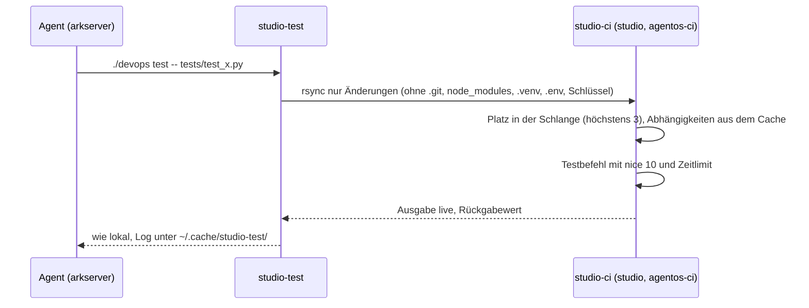

## studio-test: Agenten-Tests auf studio statt auf arkserver

Issue #3999, Auftrag Alex in Post 6490. Agenten auf arkserver starten Tests mit einem Befehl. Der
Arbeitsbaum geht per rsync an studio, ohne Commit. Die Tests laufen dort, Ausgabe und Rückgabewert
kommen zurück wie bei einem lokalen Lauf. Ist studio nicht erreichbar oder voll, läuft der Test
gedrosselt auf arkserver.



**Wofür, und wofür nicht:** Ein Lauf, den ein Agent startet (Benutzer `agentos-ci`), ist schnelle
Rückmeldung beim Entwickeln und entscheidet nie über `main` oder ein Release. Grund: Alle Agenten bauen und
testen dort unter demselben Benutzer, ein Test kann die geteilten Caches verändern und einem späteren Lauf
ein falsches Grün liefern. Die Release-Pipeline nimmt deshalb einen eigenen Benutzer (`agentos-release`,
siehe unten), den nur der Runner erreicht. Dessen Exit-Code ist ein Pipeline-Ergebnis.

### Benutzung

```bash
./devops test                         # ganze Suite nach Konfiguration
./devops test -- tests/test_x.py -x   # Argumente gehen an den Testbefehl
./devops test --detach                # Lauf-ID, nicht warten
studio-test status <lauf-id>          # Stand
studio-test log <lauf-id>             # volles Log
studio-test --local                   # gleich auf arkserver, gedrosselt
studio-test ping                      # studio erreichbar, Plätze belegt
```

Rückgabewerte: der des Tests; 124 bei Zeitlimit; Rückfall auf arkserver bei rc 255 (keine Verbindung)
oder 75 (alle Plätze länger als `TEST_WAIT` belegt).

### Konfiguration je Repo

`.devops/studio-test.conf`, alles optional:

```ini
TEST_DIR=backend
TEST_SETUP=python
TEST_CMD=python -m pytest -q -n 8
TEST_PIP=pytest-asyncio==1.3.0 greenlet
TEST_WAIT=600
```

### Aufteilen (große Suiten)

```ini
TEST_TEILE=6
TEST_DATEIEN=tests/test_*.py
```

- Die Dateien aus `TEST_DATEIEN` (Muster relativ zu `TEST_DIR`, mehrere durch Leerzeichen) gehen sortiert
  reihum auf `TEST_TEILE` Prozesse, wie in `release.yml` von cloud-api (#3718). Bekannte
  Reihenfolge-Abhängigkeiten bleiben je Teil erhalten.
- Jeder Teil bekommt ein eigenes `TMPDIR` und `STUDIO_TEIL=<n>`. Wer Daten nach `$TMPDIR` schreibt (wie
  cloud-api mit `CLOUD_API_DATA_DIR`), ist damit je Teil getrennt.
- Rückgabewert 0 nur, wenn alle Teile 0 liefern. Die Ausgabe zeigt je Teil `FAILED`/`ERROR` und die letzte
  Zeile, `studio-test log <id>` die vollen Logs aller Teile.
- `TEST_OHNE` bzw. `--ohne MUSTER` (mehrfach) lässt Dateien beim Aufteilen aus, etwa solche, die Linux
  oder Git-Verlauf brauchen. Die Ausgabe nennt die Zahl.
- Für einen Lauf: `--teile N`. Steht unter den Testargumenten ein Pfad (`-- tests/test_x.py`), wird nicht
  aufgeteilt.
- Beim Rückfall auf arkserver wird genauso aufgeteilt, die CPU-Quote je Teil entsprechend kleiner.
- `pytest -n` (xdist) ist kein Ersatz: Bei cloud-api sammeln die Worker verschiedene Testlisten und
  brechen ab.

`TEST_PIP` sind zusätzliche Pakete für die Python-Umgebung auf studio. Erlaubt sind nur Paketnamen,
optional mit Extras und Versionsangabe, keine Optionen, URLs oder Pfade. Sie fließen in den
Cache-Schlüssel ein.

Ohne Datei: `requirements.txt` ergibt Python mit `python -m pytest -q`, eine `package.json` mit
`test`-Skript ergibt Node mit `npm test --`.

### Abgleich mit Produktion (Python)

`studio-test` schickt Python-Version und Paketversionen der Produktion als `.studio-test/` mit. Quelle,
in dieser Reihenfolge (#4064):

1. `TEST_PROD_VENV` bzw. `--prod-venv`, wenn gesetzt.
2. `/var/lib/agentos/prod-pakete/<repo>.json` (Ordner änderbar über `STUDIO_PROD_PAKETE`). Diese Datei
   schreibt ein Sammler (Cloud-Operator) aus dem **laufenden** venv des Dienstes auf dem Rechner, auf dem er
   in Produktion läuft; die Zuordnung kommt aus `cloud-api/.devops/tenant/kern.json`. Läuft ein Dienst auf
   mehreren Rechnern, steht der älteste Stand in `pakete`, die anderen unter `abweichung`.
   ```json
   {"dienst": "auth-api", "stand": "2026-11-26T07:30:00Z",
    "quelle": {"host": "arkturian", "unit": "auth-api.service", "venv": "/var/www/auth-api/.venv"},
    "python": "3.11", "pakete": ["fastapi==0.136.1", "starlette==1.0.0"],
    "abweichung": [{"host": "arkserver", "venv": "…", "python": "3.11", "anders": ["fastapi==0.141.1"]}]}
   ```
   Die Ausgabe nennt Rechner, Pfad und Stand, jede Abweichung als eigene Zeile.
3. Rückfall: die venv auf arkserver (`/var/www/<repo>/venv`, `.venv` oder `/var/www/<repo>.arkturian.com/venv`;
   der Name kommt aus der Adresse von `origin`). Die Ausgabe sagt dann „Rückfall arkserver-venv“.

Ist die Datei aus 2. unlesbar, enthält ungültige Zeilen oder ist älter als 48 h, gilt ohne `--streng`
der Rückfall mit Hinweis, mit `--streng` endet der Lauf mit rc 3. Fehlt die Datei, ist das kein Fehler.

studio-ci baut die
Umgebung dann mit derselben Python-Version (falls auf studio vorhanden) und den Versionen als
`pip -c`-Vorgabe. Braucht der Arbeitsstand neuere Pakete als Produktion, löst pip die Vorgabe nicht
auf. Dann baut studio-ci ohne Vorgabe und schreibt einen Hinweis in die Ausgabe.

- `TEST_PROD_VENV=/pfad/zur/venv` (oder `--prod-venv`) nimmt eine bestimmte venv, `aus` schaltet den
  Abgleich ab.
- **Testwerkzeuge** aus `requirements-test.txt`, `requirements-dev.txt` und `TEST_PIP` (dazu `pytest-xdist`)
  nehmen die Version des Repos, nicht die der Produktion. Die Ausgabe nennt sie. Steht ein Paket auch in
  `requirements.txt` bzw. `requirements.lock`, gilt für es weiter die Version der Produktion.
- **Streng** (`--streng` bzw. `TEST_STRENG=1`, für das Release-Tor): Alle übrigen Pakete in genau der
  Version der Produktion, Python wie in Produktion. Geht das nicht, endet der Lauf mit rc 3 statt ohne
  Vorgabe weiterzubauen. Ein Rückfall auf arkserver findet nicht statt: Bei rc 255 oder 75 rechnet der
  Aufrufer selbst mit seiner Umgebung.
- Liegt die Produktion nicht auf arkserver und gibt es noch keine Datei aus 2., gehören die Versionen als
  `requirements.lock` ins Repo. Das ist ohnehin der gründlichere Weg.

### Testabhängigkeiten

- **Python:** `pytest` und `pytest-xdist` sind immer dabei. Was die Tests sonst brauchen, etwa
  `pytest-asyncio`, gehört in `requirements-test.txt` oder `requirements-dev.txt` neben
  `requirements.txt` oder in `TEST_PIP`. Alles fließt in den Cache-Schlüssel ein.
- **Offene Dateien:** macOS erlaubt einem Prozess standardmäßig 256. studio-ci hebt das je Lauf an
  (bis 65536), sonst brechen größere Suiten mit `Errno 24` ab.
- **Tests, die kein pytest sind** (eigenständige Skripte wie bei issue-api): `TEST_CMD` setzen.
- **Node:** Private Pakete aus GitHub Packages (z. B. `@arkturian/…`) brauchen auf studio einen
  Lese-Token. `.npmrc` geht nie mit. Ohne Token bricht `npm ci` mit 401 ab.

### Was nie mitgeht

`.git` (auch als Datei in einem git worktree), `node_modules`, `.venv`, `venv`, `.env*`, `*.key`, `*.pem`, `*.p12`, `secrets/`,
`.secrets/`, `.npmrc`, `.pypirc`, `*.db`, `*.sqlite*`, `dist/`, `build/` sowie alles aus
`.gitignore`. Dateien über 50 MB werden nicht übertragen. Tests müssen ohne Zugangsdaten laufen.

### Caches auf studio

- **Python:** venv je Hash von `requirements.lock`, `requirements*.txt`, `TEST_PIP` und der Python-Version
  unter `~/ci/cache/venv/`. Gibt es eine `requirements.lock`, wird sie statt `requirements.txt` installiert.
  `pytest` und `pytest-xdist` sind immer dabei.
- **Node:** `npm ci` je Hash von `package.json` und `package-lock.json` unter `~/ci/cache/node/`.
  Der Arbeitsbereich bekommt einen APFS-Klon (`cp -c`), sofort und ohne Platzbedarf. Lokale
  `file:`-Abhängigkeiten (etwa `vendor/*.tgz`) kommen mit und zählen zum Cache-Schlüssel.
- `studio-ci aufraeumen` löscht Läufe nach 7 Tagen sowie Caches und Arbeitsbereiche nach 14 Tagen
  ohne Nutzung.

### Einrichtung auf studio (Cloud-Operator)

1. Benutzer `agentos-ci`: kein Admin, kein Zugriff auf fremde Bereiche. Homebrew-`python3.13`,
   `node`/`npm` und `rsync` 3.x müssen für ihn ausführbar sein.
2. `studio-ci` nach `/Users/agentos-ci/bin/studio-ci`, Besitzer `root:wheel`, Modus `0755`.
3. `~agentos-ci/.ssh/authorized_keys`, Besitzer `root`, für agentos-ci nicht schreibbar:

   ```
   command="/Users/agentos-ci/bin/studio-ci gate",no-port-forwarding,no-agent-forwarding,no-X11-forwarding,no-pty ssh-ed25519 AAAAC3NzaC1lZDI1NTE5AAAAIABRw8x5FsuDypgDzOwWBJoWHYeaxp9QE8Ys8crtkLa2 studio-test@arkserver (#3999)
   ```

   Warum root-eigen: Tests führen Code des Repos als agentos-ci aus. Gehören `authorized_keys` oder
   das Gate dem Benutzer, könnte ein Test den Zwangsbefehl entfernen.
4. Optional ein Aufräumen per launchd, täglich `studio-ci aufraeumen`.

### Einrichtung auf arkserver (GitHub)

```bash
sudo install -o root -g root -m 755 devops-tools/studio-test/studio-test /usr/local/bin/studio-test
```

`~/.ssh/config` von alex:

```
Host studio-ci
  HostName localhost
  Port 3342
  User agentos-ci
  ProxyJump arkturian
  IdentityFile ~/.ssh/studio_ci_ed25519
  IdentitiesOnly yes
```

### Pipeline-Benutzer `agentos-release` (Release-Suite)

Für Ergebnisse, die über `main` entscheiden, gilt `agentos-ci` nicht (gemeinsame Caches der Agenten). Die
Pipeline nimmt einen eigenen Benutzer auf studio mit demselben `studio-ci`:

- **studio:** Benutzer `agentos-release`, eingerichtet wie `agentos-ci` (Punkte 1 bis 4 oben), eigene
  `authorized_keys` mit dem Schlüssel des Runners. `studio-ci` rechnet mit `Path.home()`, Caches und
  Arbeitsbereiche liegen getrennt unter `~agentos-release/ci`. Kein gegenseitiger Lesezugriff.
- **Runner auf arkserver** (`github-runner`): Schlüssel `~/.ssh/studio_release`. Der Sprung über arkturian
  nimmt das vorhandene Konto `studio-deploy` (darf nur nach `127.0.0.1:3342`), nie einen Schlüssel von alex.
  `~github-runner/.ssh/config`:

  ```
  Host studio-release
    HostName localhost
    Port 3342
    User agentos-release
    IdentityFile ~/.ssh/studio_release
    IdentitiesOnly yes
    HostKeyAlias studio
    ProxyCommand ssh -i ~/.ssh/studio_deploy -o IdentitiesOnly=yes -o BatchMode=yes -W 127.0.0.1:3342 studio-deploy@arkturian.com
  ```

- **Im Workflow:** derselbe Client, nur Host und Name des Arbeitsbereichs gesetzt:

  ```yaml
  - name: Suite auf studio
    env:
      STUDIO_TEST_HOST: studio-release
      AGENT_NAME: release
    run: studio-test --streng --teile 6 -- --tb=no -rfE
  ```

  Der Exit-Code ist das Ergebnis. Mit `--streng` gibt studio-test bei rc 255 (nicht erreichbar) oder 75
  (voll) diesen Wert zurück, die Pipeline rechnet dann selbst. rc 3: Umgebung nicht wie in Produktion.

### Git im Arbeitsbereich

`.git` geht nie mit. Damit Tests mit `git ls-files` trotzdem laufen, schickt `studio-test` die Liste
der versionierten Dateien mit (`.studio-test/tracked`). studio-ci baut daraus vor jedem Lauf einen
Git-Index ohne Verlauf. Dateien, die nicht übertragen wurden (etwa `.env`), fehlen darin. `git log`,
`git diff` und `git blame` liefern dort nichts. `HEAD` ist ein einzelner Ersatz-Commit ohne Eltern, damit
`git rev-parse HEAD` antwortet; sein Hash ist nicht der des Repos; Tests, die den Verlauf brauchen, gehören auf
`--local`.

### Grenzen

- **Gate:** Es erlaubt nur rsync als Empfänger in `~/ci/ws/<name>/` sowie `studio-ci run|status|log|ping`.
  Es verhindert Shell, Portweiterleitung und Pfade außerhalb von `~/ci`. Ein Test ist trotzdem
  beliebiger Code. Die Trennung zum Rest von studio leistet allein der Benutzer `agentos-ci`.
- **Plattform:** studio ist macOS auf arm64. Tests, die Linux brauchen (systemd, `/proc`, native
  Linux-Pakete), laufen mit `--local` auf arkserver.
- **Mehrere Läufe:** Ein Agent und ein Repo teilen sich einen Arbeitsbereich. Zwei gleichzeitige
  Läufe desselben Agenten im selben Repo warten aufeinander.
