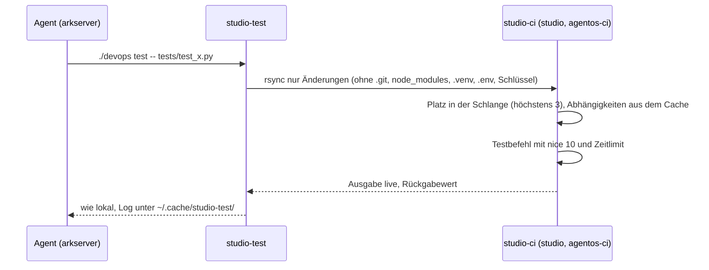

## studio-test: Agenten-Tests auf studio statt auf arkserver

Issue #3999, Auftrag Alex in Post 6490. Agenten auf arkserver starten Tests mit einem Befehl. Der
Arbeitsbaum geht per rsync an studio, ohne Commit. Die Tests laufen dort, Ausgabe und Rückgabewert
kommen zurück wie bei einem lokalen Lauf. Ist studio nicht erreichbar oder voll, läuft der Test
gedrosselt auf arkserver.



### Benutzung

```bash
./devops test                         # ganze Suite nach Konfiguration
./devops test -- tests/test_x.py -x   # Argumente gehen an den Testbefehl
./devops test --detach                # Lauf-ID, nicht warten
studio-test status <lauf-id>          # Stand
studio-test log <lauf-id>             # volles Log
studio-test --local                   # gleich auf arkserver, gedrosselt
studio-test ping                      # studio erreichbar, Plätze belegt
```

Rückgabewerte: der des Tests; 124 bei Zeitlimit; Rückfall auf arkserver bei rc 255 (keine Verbindung)
oder 75 (alle Plätze länger als `TEST_WAIT` belegt).

### Konfiguration je Repo

`.devops/studio-test.conf`, alles optional:

```ini
TEST_DIR=backend
TEST_SETUP=python
TEST_CMD=python -m pytest -q -n 8
TEST_WAIT=600
```

Ohne Datei: `requirements.txt` ergibt Python mit `python -m pytest -q`, eine `package.json` mit
`test`-Skript ergibt Node mit `npm test --`.

### Testabhängigkeiten

- **Python:** `pytest` und `pytest-xdist` sind immer dabei. Was die Tests sonst brauchen, etwa
  `pytest-asyncio`, gehört in `requirements-test.txt` oder `requirements-dev.txt` neben
  `requirements.txt`. Beide Dateien fließen in den Cache-Schlüssel ein.
- **Node:** Private Pakete aus GitHub Packages (z. B. `@arkturian/…`) brauchen auf studio einen
  Lese-Token. `.npmrc` geht nie mit. Ohne Token bricht `npm ci` mit 401 ab.

### Was nie mitgeht

`.git`, `node_modules`, `.venv`, `venv`, `.env*`, `*.key`, `*.pem`, `*.p12`, `secrets/`,
`.secrets/`, `.npmrc`, `.pypirc`, `*.db`, `*.sqlite*`, `dist/`, `build/` sowie alles aus
`.gitignore`. Dateien über 50 MB werden nicht übertragen. Tests müssen ohne Zugangsdaten laufen.

### Caches auf studio

- **Python:** venv je Hash der `requirements*.txt` und der Python-Version unter `~/ci/cache/venv/`.
  `pytest` und `pytest-xdist` sind immer dabei.
- **Node:** `npm ci` je Hash von `package.json` und `package-lock.json` unter `~/ci/cache/node/`.
  Der Arbeitsbereich bekommt einen APFS-Klon (`cp -c`), sofort und ohne Platzbedarf.
- `studio-ci aufraeumen` löscht Läufe nach 7 Tagen sowie Caches und Arbeitsbereiche nach 14 Tagen
  ohne Nutzung.

### Einrichtung auf studio (Cloud-Operator)

1. Benutzer `agentos-ci`: kein Admin, kein Zugriff auf fremde Bereiche. Homebrew-`python3.13`,
   `node`/`npm` und `rsync` 3.x müssen für ihn ausführbar sein.
2. `studio-ci` nach `/Users/agentos-ci/bin/studio-ci`, Besitzer `root:wheel`, Modus `0755`.
3. `~agentos-ci/.ssh/authorized_keys`, Besitzer `root`, für agentos-ci nicht schreibbar:

   ```
   command="/Users/agentos-ci/bin/studio-ci gate",no-port-forwarding,no-agent-forwarding,no-X11-forwarding,no-pty ssh-ed25519 AAAAC3NzaC1lZDI1NTE5AAAAIABRw8x5FsuDypgDzOwWBJoWHYeaxp9QE8Ys8crtkLa2 studio-test@arkserver (#3999)
   ```

   Warum root-eigen: Tests führen Code des Repos als agentos-ci aus. Gehören `authorized_keys` oder
   das Gate dem Benutzer, könnte ein Test den Zwangsbefehl entfernen.
4. Optional ein Aufräumen per launchd, täglich `studio-ci aufraeumen`.

### Einrichtung auf arkserver (GitHub)

```bash
sudo install -o root -g root -m 755 devops-tools/studio-test/studio-test /usr/local/bin/studio-test
```

`~/.ssh/config` von alex:

```
Host studio-ci
  HostName localhost
  Port 3342
  User agentos-ci
  ProxyJump arkturian
  IdentityFile ~/.ssh/studio_ci_ed25519
  IdentitiesOnly yes
```

### Grenzen

- **Gate:** Es erlaubt nur rsync als Empfänger in `~/ci/ws/<name>/` sowie `studio-ci run|status|log|ping`.
  Es verhindert Shell, Portweiterleitung und Pfade außerhalb von `~/ci`. Ein Test ist trotzdem
  beliebiger Code. Die Trennung zum Rest von studio leistet allein der Benutzer `agentos-ci`.
- **Plattform:** studio ist macOS auf arm64. Tests, die Linux brauchen (systemd, `/proc`, native
  Linux-Pakete), laufen mit `--local` auf arkserver.
- **Mehrere Läufe:** Ein Agent und ein Repo teilen sich einen Arbeitsbereich. Zwei gleichzeitige
  Läufe desselben Agenten im selben Repo warten aufeinander.
